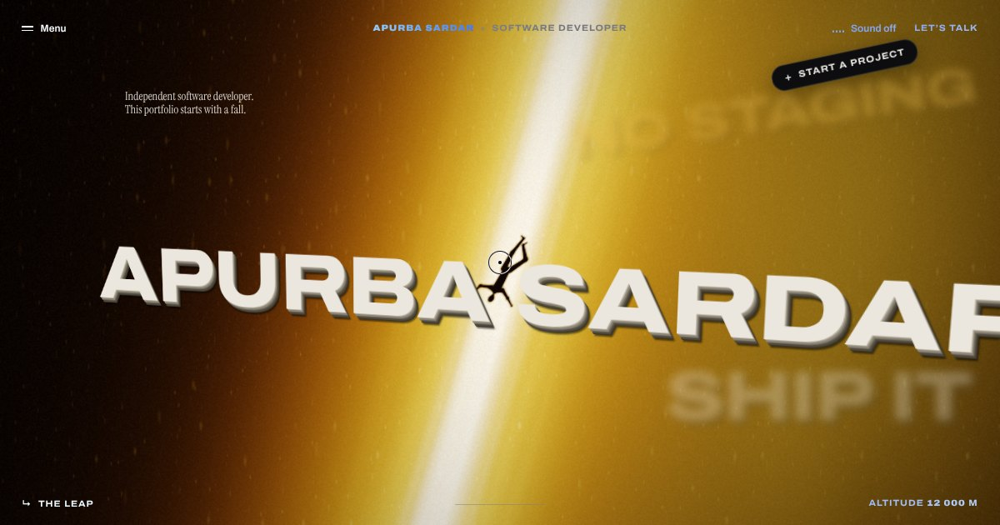

# Apurba Sardar — cinematic portfolio

**Live:** https://apurba-sardar.github.io/Apu001/



A scroll-driven, cinematic portfolio told as one continuous fall:

**The Leap → Impact → The Noise → Rise → Index of work → Selected work → About → Stack → Services → The Portal → Contact**

Every background is a real-time WebGL2 "film" rendered in the browser (no stock footage, no heavy video files),
scrubbed by scroll and layered with motion typography in GSAP.

| Chapter | What happens |
| --- | --- |
| **The Leap** | A figure tumbles down a shaft of golden light. 3D words (`DEPLOY`, `SHIP IT`, `NO STAGING`…) and code snippets rush past, captions blend in `difference` mode, and an altitude counter falls from 12 000 m to 0. The light "gets louder" into a god-ray burst and whites out. |
| **Impact** | `IMPACT` slams into the frame and shakes it. |
| **The Noise** | Top-down crowd around a burning figure; a hollow `NOISE` rises through the frame with the usual noise (*"it works on my machine"*, *"just add AI"*…). A shockwave clears it all. |
| **Rise** | The letters of `RISE` fly in from every direction and invert the film beneath them. A figure of cold light stands up. |
| **Index of work** | The film shrinks into a card while project tiles fly towards the camera through a 3D tunnel. |
| **Selected work** | My two ventures, [Webnestle](https://webnestle.in) and [LootDost](https://lootdost.in), each with a giant marquee title, a spinning "record" (live WebGL) wrapped in rotating ring text, details and a link to the live site. Titles collapse into bars as they leave. |
| **About / Stack / Services** | Word-by-word statement reveal, an outline marquee of the stack, and a services list that floods white on hover with a preview card trailing the cursor. |
| **The Portal** | Storm clouds part above mountains, a slit of light opens into a door, lightning crawls out and a hooded developer walks through it towards the camera — then the closing headline. |
| **Contact** | Availability, a huge gold email, a live clock and a way back to the top. |

Also included: smooth scrolling (Lenis), a `difference`-blend custom cursor, a full-screen chapter menu with previews,
a generative WebAudio soundtrack (drone, falling wind that follows your scroll speed, crowd murmur, impact boom,
portal choir — no audio files), a loader and `prefers-reduced-motion` support.

On phones and tablets: portrait layouts (case titles above the records, cases that scroll in one after another),
~44px touch areas on every control, safe-area insets for notches and the home indicator, floating words that stay
on screen and step aside for captions, and services that light up as they cross the middle of the screen
instead of on hover.

## Run it

```bash
npm install
npm run dev       # http://localhost:5173
npm run build     # static site in dist/
npm run preview   # serve the production build
```

`dist/` is plain static files with relative paths, so it deploys anywhere:

- **Vercel / Netlify**: import the repo, build command `npm run build`, output directory `dist`.
- **GitHub Pages** (already set up here): `.github/workflows/deploy.yml` builds the site on every push to `main` or
  `claude/portfolio-motion-graphics-4hs1k6` and publishes `dist/` to the `gh-pages` branch, which Pages serves
  (Settings → Pages → Deploy from a branch → `gh-pages`, `/ (root)`), then waits until the live site serves the
  new build; the run fails if the site can't be reached. To redeploy by hand: Actions →
  *Deploy to GitHub Pages* → *Run workflow*. Paths are relative, so the `/Apu001/` sub-path just works.

## Make it yours

Everything you read on the site lives in **`src/content.js`**:

- `brand` — name, short wordmark, role, intro line, monogram.
- `leap.words`, `noise.phrases`, `rise.side` — the words that fly past in each chapter.
- `work.projects` — name, colour, ring text, description, details and which film plays in the record
  (`leap`, `ember`, `crowd`, `portal`). With a `url`, the record and the button open the live site;
  without one, the button leads to contact. An optional `year` shows next to the record.
- `about`, `stack`, `services` — statement, marquee rows, services and their preview images.
- `portal.cta` — the closing headline (`\n` = line break).
- `contact` — email, socials, availability line, and your city + IANA timezone for the live clock
  (`city: 'Kolkata'`, `timezone: 'Asia/Kolkata'`, `timezoneLabel: 'IST'`).

Images used by the menu, the index tunnel and the services previews are in `public/media/`.
Swap in your own screenshots (any aspect ratio, they are cropped with `object-fit: cover`) or re-render
them from the shaders — see [Re-rendering the media](#re-rendering-the-media).

### Timing

Each cinematic chapter is a scroll "spacer" whose length is set by `vh` in its scene file
(`src/scenes/*.js`, e.g. `vh: 640` = 6.4 screens of scroll for the leap). Inside, every effect is keyed to the
chapter progress `p` (0 → 1), so retiming is a matter of changing those ranges.

## How it works

```
src/
  content.js            all copy
  app.js                boot, loader, Lenis + GSAP ticker, render loop, navigation
  core/stage.js         fixed scene layers that behave like position: sticky
  core/hud.js menu.js cursor.js sound.js video.js
  gl/renderer.js        tiny WebGL2 renderer built around "views" (full-screen, rect or circle)
  gl/shaders/           common.glsl (noise, SDF human), leap.glsl, crowd.glsl, portal.glsl
  scenes/               leap, impact, noise, rise, gallery, portal  (scroll-driven chapters)
  sections/             work, about, clients (stack), services, contact (normal flow)
tools/                  shader lab, tile designs and the media renderer (dev only)
```

- **Why fixed layers instead of pinning?** Sticky or pinned containers create isolated stacking contexts, which
  breaks `mix-blend-mode: difference` against the WebGL canvas (the blue-over-gold captions, the inverted `RISE`).
  The stage keeps every scene layer at the root of the page and moves it exactly like `position: sticky` would.
- **One canvas, many views.** The full-screen films, the shrinking card in the index and the four spinning records
  in Selected work are all drawn by the same WebGL context using viewport + scissor rectangles that follow DOM
  elements.
- **Adaptive quality.** Resolution drops automatically on slow GPUs and recovers when frames are fast.

## Real footage instead of the procedural films (optional)

Each film can be replaced by a video that is scrubbed by scroll. Put the file in `public/videos/` and set it in
`content.videos`:

```js
videos: { leap: 'videos/leap.mp4', noise: 'videos/noise.mp4', portal: 'videos/portal.mp4' }
```

Encode with a keyframe on every frame so scrubbing is smooth:

```bash
ffmpeg -i input.mp4 -an -vf scale=1920:-2 -c:v libx264 -crf 22 -g 1 -pix_fmt yuv420p public/videos/leap.mp4
```

Prompts that match the films, for an AI video generator (Veo, Sora, Kling, Runway…):

- **leap** — *"Cinematic slow motion, a lone man in dark clothes falling head-first down an endless vertical
  shaft of golden light, sparks and light streaks rushing upward past him, glowing gold ribbons spiralling
  around the beam, dark amber and umber surroundings, anamorphic lens, film grain, 10 seconds, the light
  intensifies into a blinding white burst at the end."*
- **noise** — *"Top-down drone shot at night, a dense crowd standing in a circle around a man lying on the ground
  who is burning like an ember, warm firelight on the faces of the crowd, some people in red jackets, sparks
  drifting, then a bright shockwave of light pushes the crowd back and the man stands up glowing with cold
  white-blue light."*
- **portal** — *"Dark stormy night above jagged mountains, pink-lit cumulus clouds part to reveal a vertical slit of
  red light that opens into a tall glowing doorway, lightning crawls out of its edges, a young developer in a
  hoodie walks out of the light towards the camera, slow push-in to a close-up, cinematic, volumetric light."*
  (Use your own photo as the reference image to star in it.)

## Re-rendering the media

```bash
npm run dev                                   # keep running
npm i -D playwright && npx playwright install chromium
node tools/render-media.mjs                   # writes public/media/*
```

`tools/lab.html` renders a single frame of any scene with any uniforms, e.g.
`/tools/lab.html?scene=portal&w=1280&h=720&u={"uOpen":1,"uFigure":1,"uWalk":0.5}` — handy for tuning shaders.

## Credits

Fonts: [Archivo](https://github.com/Omnibus-Type/Archivo), [Instrument Serif](https://github.com/Instrument/instrument-serif)
and [JetBrains Mono](https://github.com/JetBrains/JetBrainsMono) (SIL Open Font License).
Libraries: [GSAP](https://gsap.com), [Lenis](https://github.com/darkroomengineering/lenis), [Vite](https://vite.dev).
Inspired by a cinematic portfolio concept shared on Instagram by @itsgireesh.uiux.
